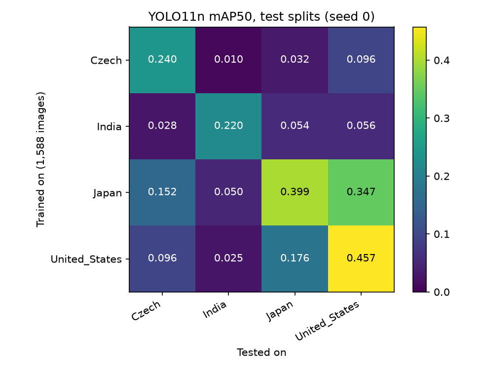
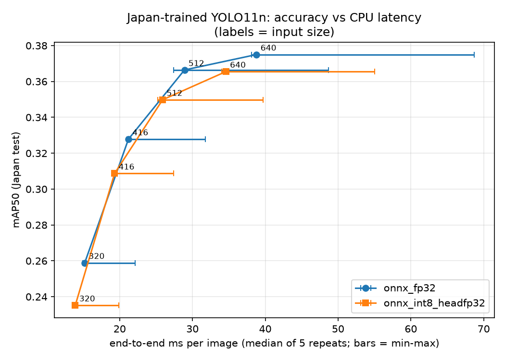

# Road damage detection across countries (RDD2022)

How much does a small road-damage detector lose when it is tested on a country it was not trained on, and what does INT8 compression cost on a laptop CPU?

This is a learning/portfolio project, not a deployable system. All numbers come from a single training seed (seed 0), so differences of a few thousandths of mAP should not be read as real.

## Main findings

- **In-country scores are the highest in every row; every cross-country score is far lower.** mAP50 on each country's own test split: Czech 0.2399, India 0.2195, Japan 0.3986, United States 0.4574. Cross-country scores range from 0.0104 to 0.3472.
- **Transfer is asymmetric.** Japan-trained to US test: 0.3472. US-trained to Japan test: 0.1758.
- **INT8 mainly saves size, not time.** On the Japan-trained model at 640: model size 10.7 MB to 4.5 MB, mAP50 0.3750 to 0.3655, end-to-end CPU latency 38.8 ms to 34.6 ms (about 11% faster). FP32 at 512 reaches 0.3664 in 28.9 ms, so simply lowering input size gave a similar accuracy at lower latency than INT8 at 640.
- **Plain INT8 failed completely** (mAP50 0.0000) until the Detect head was kept in FP32. See `docs/what_didnt_work.md`.

## Data

- Dataset: RDD2022 (CRDDC2022), Arya et al., CC BY-SA 4.0. Figshare DOI 10.6084/m9.figshare.21431547.
- Citation: Arya, Deeksha; Maeda, Hiroya; Sekimoto, Yoshihide; Omata, Hiroshi; Ghosh, Sanjay Kumar; Toshniwal, Durga; et al. (2022). RDD2022 - The multi-national Road Damage Dataset released through CRDDC'2022. figshare. Dataset. https://doi.org/10.6084/m9.figshare.21431547.v1
- Used: India, Japan, Czech, United States. Norway and China were not used.
- The official test folders have no labels, so all evaluation uses my own splits of the labelled train folders.
- Target classes: D00 longitudinal crack, D10 transverse crack, D20 alligator crack, D40 pothole. Other classes present in India/Japan files (D01, D0w0, D11, D43, D44, D50) were dropped. After dropping them, the box totals match the dataset paper: India 6,831, Japan 16,470, Czech 1,745, US 11,014.
- The India images come mainly from Delhi, Gurugram and Haryana, so nothing here says anything about Tamil Nadu or other Indian regions.

## Train/validation/test splits

Random splits leak in this dataset: the same road stretch appears in many images that are not neighbours by file ID. So splits are grouped by image similarity (details and limits in `docs/split_plan.md`):

1. 32x32 grayscale thumbnails, z-scored; link image pairs with correlation >= 0.97 and merge them into groups.
2. Assign whole groups to test (~20%), val (~10%) or train (the rest), seed 0.
3. Purge train/val images with correlation >= 0.95 to any test image (and train images to val).

| Country | Train | Val | Test | Purged |
|---|---|---|---|---|
| United States | 3,323 | 476 | 961 | 45 |
| Japan | 7,257 | 1,040 | 2,102 | 107 |
| Czech | 1,588 | 262 | 566 | 413 |
| India | 4,457 | 678 | 1,542 | 1,029 |

Known limits of this split: the similarity measure is crude and the cut-offs were judged by eye from a few sampled pairs; near-copies with correlation 0.92 to 0.95 are not removed (before purging, 56.6% of Czech and 57.6% of India val images still had a train image at >= 0.92); exact duplicates exist; test boxes for rare classes are tiny (US D40 = 29, India D10 = 18), so I make no per-class claims.

## Cross-country results

Setup: YOLO11n (about 2.6M parameters), 50 epochs, seed 0, trained on a free Colab GPU. Each model is trained on 1,588 images from one country (Czech's whole train split is 1,588 images, so the sets are the same size) and tested on every country's own test split. One run per cell.

mAP50, rows = trained on, columns = tested on:

| Trained on | Czech | India | Japan | United States |
|---|---|---|---|---|
| Czech | **0.2399** | 0.0104 | 0.0324 | 0.0960 |
| India | 0.0283 | **0.2195** | 0.0541 | 0.0557 |
| Japan | 0.1524 | 0.0495 | **0.3986** | 0.3472 |
| United States | 0.0955 | 0.0253 | 0.1758 | **0.4574** |

All values (mAP50-95 and per-class mAP50) are in `results/results.csv`.

What the table shows:
- The in-country score is the highest in every row, and every cross-country score is much lower.
- Transfer is asymmetric: Japan to US is 0.3472, US to Japan is 0.1758.
- Models tested on India score lowest: the average of the three off-diagonal scores is 0.028, against 0.087 (Japan), 0.092 (Czech) and 0.166 (US). India's test split was also the most heavily purged (1,029 images), so I do not claim India is intrinsically harder.

What the table does not show:
- Differences have no confidence intervals (one seed), and I did not test them for significance.
- Test sets differ in composition: every US image contains at least one target box, versus 41.8% of India images and 37.9% of Czech images, so comparing columns is less reliable than comparing within a column.
- Rare-class test boxes are few (US D40 = 29, India D10 = 18), so I make no per-class claims.

## Compression (Japan-trained model)

The Japan-trained model was exported to ONNX and quantised to INT8 (static, QDQ, per-channel, calibrated on 100 images from the Japan train split). Latency was measured on my laptop CPU (Intel i5-13420H, no GPU) with ONNX Runtime through Ultralytics, one image at a time (batch size 1). The timer wraps the whole `predict` call on a JPEG file path, so "end-to-end" includes reading and decoding the image, resizing and padding it to the input size, the network, and non-maximum suppression. It excludes model loading and a 5-image warm-up. For each model and input size I took the median time over 55 Japan test images (the first 60 files in sorted order, minus the 5 warm-up images, so not a random sample), repeated this 5 times with the models interleaved, and report the median of those 5 values. The min-max range in `results/latency_repeats.csv` and the bars in the plot are the spread of those 5 repeat medians. `infer_median_ms` in that file is Ultralytics' own timer for the network run alone. I did not set the number of CPU threads, and absolute numbers are specific to this laptop

Reference scores on the Japan test split: PyTorch FP32 0.3986 mAP50. The ONNX FP32 model at 640 scores 0.3750; I did not find the cause of this gap (see below).

| Input size | mAP50 FP32 | mAP50 INT8 | ms FP32 | ms INT8 | Latency change |
|---|---|---|---|---|---|
| 320 | 0.2589 | 0.2352 | 15.2 | 13.9 | -8.6% |
| 416 | 0.3278 | 0.3087 | 21.2 | 19.3 | -9.0% |
| 512 | 0.3664 | 0.3498 | 28.9 | 25.9 | -10.4% |
| 640 | 0.3750 | 0.3655 | 38.8 | 34.6 | -10.8% |

The "INT8" model keeps the Detect head (84 of 320 graph nodes) in FP32. Quantising everything gave mAP50 0.0000. With the head excluded, the 640 model has mAP50 0.3655 and mAP50-95 0.1554 (FP32 ONNX: 0.3750 and 0.1598), and its file size drops from 10.7 MB to 4.5 MB.

What this shows:
- INT8 saves a lot of file size (about 58% at 640) and only about 9 to 11% of CPU time, with a small accuracy loss.
- Lowering the input size is just as effective as quantising: FP32 at 512 (0.3664 mAP50, 28.9 ms) is about as accurate as INT8 at 640 (0.3655, 34.6 ms) and faster. The accuracy difference is far below what one seed can resolve.
- Single runs of this measurement were noisy (max times reach 68.7 ms at 640 FP32), which is why I report medians of repeats.
## What didn't work

- **Plain INT8 quantisation collapsed.** Quantising the whole model gave mAP50 0.0000. Keeping the 84 Detect-head nodes (of 320) in FP32 restored it (0.3655 at 640).
- **ONNX FP32 scores lower than PyTorch FP32 and I do not know why.** Japan test, 640: PyTorch 0.3986, ONNX 0.3750. Raw model outputs agree to 0.0025 px on 20 images, so I suspect a difference in how validation letterboxes the image, but I did not test this.
- **Full-size cross-country runs were not done.** Colab was too slow, so all countries are compared at the same 1,588 training images.
- **A wrong first conclusion about latency.** A single timing pass suggested INT8 was slower at 320 and 416. Five interleaved repeats showed INT8 faster at every size; the single pass was affected by an unexplained machine slowdown and was discarded.

More detail is in `docs/what_didnt_work.md`.

## Limitations

- One training seed, no confidence intervals, no significance tests.
- Evaluation uses my own splits of the labelled train folders, because the official test folders have no labels. Scores are therefore not comparable to published RDD2022 results.
- Rare-class test sets are tiny (US D40 = 29 boxes, India D10 = 18), so no per-class claims.
- The split method uses crude pixel similarity with hand-judged cut-offs; near-copies at correlation 0.92 to 0.95 remain, and exact duplicates exist. A pale vertical bar in several Japan images is unexplained.
- One model family (YOLO11n) and one training length (50 epochs).
- The India images come mainly from Delhi, Gurugram and Haryana. Nothing here says anything about other regions or about deployment readiness.

## Planned but not done

Augmentation ablations, class-imbalance handling, knowledge distillation, a MobileNet-based detector, multiple seeds with confidence intervals, full-size cross-country runs, and finding the cause of the ONNX-versus-PyTorch gap.
